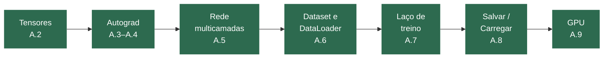

# Apêndice A — Introdução ao PyTorch

Status: ✅ concluído

> Apêndice A do projeto **Asphal-LLM** · base de tudo que os [Capítulos 2 a 7](../../sprints/) usam



## Estrutura

```
appendix-A/
├── README.md
├── glossario/apendiceA.md                    # 29 termos
├── docs/apendiceA_analise.md                 # análise técnica dos resultados
├── notebooks/apendiceA.ipynb                 # exploração interativa (28 células)
├── experiments/
│   ├── fluxo_apendiceA.py                    # seções A.2–A.9 + 3 experimentos
│   └── resultados/                           # apendiceA_resultados.json
└── tests/
    └── test_pytorch_basico.py                # 16 testes pytest
```

O código reutilizável fica em [`src/pytorch_basico/`](../../src/pytorch_basico/):

| Arquivo | Conteúdo |
|---|---|
| `rede_neural.py` | `NeuralNetwork`, `contar_parametros_treinaveis`, `parametros_esperados` |
| `dados_toy.py` | `dados_toy`, `ToyDataset`, `criar_loaders_toy` |
| `treino_basico.py` | `treinar_rede`, `compute_accuracy` |

## Como rodar

```bash
# Testes (CPU, ~3 s)
python -m pytest Apendices/appendix-A/tests/ -v

# Fluxo completo + experimentos (~4 s na CPU)
python Apendices/appendix-A/experiments/fluxo_apendiceA.py
```

## Principais resultados

| Entregável | Resultado |
|---|---|
| Gradientes da regressão logística | dL/dw1 = −0,0898 e dL/db = −0,0817, iguais ao livro e à conta à mão |
| Parâmetros de `NeuralNetwork(50, 3)` | 2.213 |
| Perdas do treino (3 épocas) | 0,75 → 0,65 → 0,44 → 0,13 → 0,03 → 0,00, iguais ao livro |
| Acurácia final | 100% no treino e no teste |
| lr = 5,0 (10 épocas) | perda diverge para 6,24 e acurácia cai para 50% |

<details>
<summary>Por que a rede devolve logits e não probabilidades</summary>

`F.cross_entropy` aplica log-softmax internamente. Se o modelo já
aplicasse softmax, a perda calcularia `log(softmax(softmax(x)))`, que é
numericamente instável e treina pior. Por isso a softmax só aparece na hora
de **ler** a previsão (`torch.softmax(logits, dim=1)`). O `GPTModel` segue
a mesma regra: o `out_head` devolve logits sobre as 50.257 palavras.

</details>

<details>
<summary>Treino com várias GPUs (DDP)</summary>

A seção A.9.3 usa `DistributedDataParallel`: cada GPU recebe uma cópia do
modelo e uma fatia dos lotes (`DistributedSampler`), e os gradientes são
sincronizados a cada passo. Ela não é reproduzida aqui porque exige duas ou
mais GPUs e o backend NCCL, que não existe no Windows. Os scripts do autor
estão em `appendix-A/01_main-chapter-code/` no
[repositório oficial](https://github.com/rasbt/LLMs-from-scratch/tree/main/appendix-A).

</details>

## Resultados dos testes

| Suite | Testes |
|---|---|
| `test_pytorch_basico.py` | 16 |
| **Total** | **16** |

Análise completa e discussão → [`docs/apendiceA_analise.md`](docs/apendiceA_analise.md)
