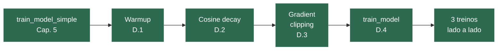

# Apêndice D — Incrementando o laço de treino

Status: ✅ concluído

> Apêndice D do projeto **Asphal-LLM** · continua o laço de treino do [Capítulo 5](../../sprints/ch05/)



## Estrutura

```
appendix-D/
├── README.md
├── glossario/apendiceD.md                    # 15 termos
├── docs/apendiceD_analise.md                 # análise técnica dos resultados
├── notebooks/apendiceD.ipynb                 # exploração interativa (13 células, modelo mini)
├── experiments/
│   ├── fluxo_apendiceD.py                    # D.1–D.4 + 3 treinos com o mesmo lr de pico
│   └── resultados/                           # apendiceD_resultados.json (+ gráficos .png)
└── tests/
    └── test_treino_avancado.py               # 11 testes pytest
```

O código reutilizável fica em [`src/training/`](../../src/training/):

| Arquivo | Conteúdo |
|---|---|
| `treino.py` | `taxa_de_aprendizado` (warmup + cosine) e `train_model` (laço do apêndice), já usados no `exp06` do Cap. 5 |
| `gradientes.py` | `find_highest_gradient` (função do livro) e `norma_do_gradiente` (a norma que o `clip_grad_norm_` usa) |

## Como rodar

```bash
# Testes (CPU, ~30 s)
python -m pytest Apendices/appendix-D/tests/ -v

# GPT-2 124M, 15 épocas, 3 treinos (como no livro; ~5 min na GTX 1650)
python Apendices/appendix-D/experiments/fluxo_apendiceD.py

# Versão rápida com o modelo mini
python Apendices/appendix-D/experiments/fluxo_apendiceD.py --config mini

# Um treino por vez (os anteriores ficam no JSON)
python Apendices/appendix-D/experiments/fluxo_apendiceD.py --so warmup_cosine_clip
```

## Principais resultados

| Entregável | Resultado |
|---|---|
| Warmup (D.1) | 27 passos de warmup em 135, iguais ao livro |
| Gradient clipping (D.3, GPT-2 124M) | norma 2,28 → 1,00; maior gradiente 0,0552 → 0,0243 (livro: 0,0446 → 0,0201) |
| lr constante 0,001 (15 épocas) | validação final 7,133 (melhor 6,593 na época 2,9) |
| + warmup + cosine | validação final **6,368** (melhor 6,238) |
| + warmup + cosine + clipping (livro) | **melhor validação de todas: 6,201**, na época 6,2; depois decora o texto (treino 0,03) |

Os três treinos usam o mesmo lr de pico e a mesma semente (GPT-2 124M, CPU).
O cronograma é o que mais ajuda; o clipping deixa o treino mais rápido, o
que neste corpus de 5 mil tokens também acelera a memorização. Detalhes na
análise.

<details>
<summary>Por que warmup e cosine decay</summary>

No início os pesos são aleatórios e os gradientes são grandes e pouco
confiáveis: passos grandes nessa fase podem jogar o modelo numa região ruim.
O **warmup** sobe a taxa de aprendizado em linha reta durante os primeiros
20% dos passos. Depois do pico, o **cosine decay** desce a taxa em meia onda
de cosseno até `min_lr`, para que os últimos passos só refinem os pesos.

</details>

<details>
<summary>O que o gradient clipping faz (e o que não faz)</summary>

O `clip_grad_norm_` calcula a norma L2 de todos os gradientes juntos e, se
ela passar de `max_norm`, multiplica todos por `max_norm / norma`: a direção
do passo continua a mesma e só o tamanho diminui. Com o AdamW, porém, o
passo de cada peso é dividido pela média móvel do gradiente ao quadrado,
então limitar o gradiente não limita diretamente o tamanho do passo. Isso
explica por que o clipping não evitou o pico de perda do passo 20 no `exp06`
do Cap. 5.

</details>

## Resultados dos testes

| Suite | Testes |
|---|---|
| `test_treino_avancado.py` | 11 |
| **Total** | **11** |

Análise completa e discussão → [`docs/apendiceD_analise.md`](docs/apendiceD_analise.md)
