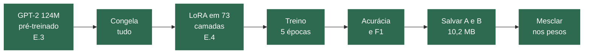

# Apêndice E — Fine-tuning eficiente em parâmetros com LoRA

Status: ✅ concluído (acurácias com o GPT-2 real a medir na GPU)

> Apêndice E do projeto **Asphal-LLM** · refaz o classificador de spam do [Capítulo 6](../../sprints/ch06-07/) com LoRA



## Estrutura

```
appendix-E/
├── README.md
├── glossario/apendiceE.md                    # 15 termos
├── docs/apendiceE_analise.md                 # análise técnica e comparação com o cap. 6
├── notebooks/apendiceE.ipynb                 # exploração interativa (17 células)
├── experiments/
│   ├── lora_classificacao.py                 # spam/ham com LoRA + comparação com o cap. 6
│   └── resultados/                           # lora_resultados.json
└── tests/
    └── test_lora.py                          # 12 testes pytest
```

O código reutilizável fica em [`src/finetuning/lora.py`](../../src/finetuning/lora.py):

| Função / classe | Conteúdo |
|---|---|
| `LoRALayer`, `LinearWithLoRA` | o desvio `(alpha/rank)·x·A·B` e a linear congelada com LoRA |
| `replace_linear_with_lora` | troca as `nn.Linear` recursivamente (com lista do que ignorar) |
| `preparar_classificador_lora` | congela o `GPTClassifier` do cap. 6 e aplica o LoRA |
| `state_dict_lora`, `mesclar_lora` | salvar só A e B; incorporar A·B nos pesos |

## Como rodar

```bash
# Testes (CPU, ~10 s)
python -m pytest Apendices/appendix-E/tests/ -v

# Pré-requisito: pesos do GPT-2 (cap. 6-7, só na 1ª vez)
python sprints/ch06-07/experiments/carregar_pesos_pretrained.py

# Para comparar, o fine-tuning do cap. 6
python sprints/ch06-07/experiments/classificacao.py

# LoRA rank 16 (padrão do livro)
python Apendices/appendix-E/experiments/lora_classificacao.py

# Outros ranks (cada um salva lora_resultados_r<rank>.json)
python Apendices/appendix-E/experiments/lora_classificacao.py --rank 8 --alpha 8
```

> Os pesos do LoRA ficam em `models/appendix-E/` (fora do git).

## Principais resultados

| Entregável | Resultado |
|---|---|
| Parâmetros treináveis (rank 16) | 2.666.528, igual ao livro (1,64% do modelo, contra 4,35% no cap. 6) |
| Camadas com LoRA | 73 de 74 `nn.Linear` (o `out_head` fica de fora: não é usado na classificação) |
| Antes do treino | saídas idênticas às do modelo sem LoRA (B = 0) |
| Arquivo do ajuste | 10,2 MB só com A e B, contra 632 MB do modelo inteiro |
| Mesclagem A·B → W | mesmas previsões, diferença máxima de 4,8 × 10⁻⁷ nos logits |
| Acurácia de teste | a medir com o GPT-2 124M (livro: ≈ 96,7%) |

<details>
<summary>Por que B começa com zeros</summary>

Com B = 0, o produto A·B é zero e a camada `LinearWithLoRA` devolve
exatamente o que a `nn.Linear` original devolveria. O fine-tuning parte do
modelo pré-treinado sem nenhuma perturbação. A matriz A começa aleatória
porque, se as duas fossem zero, os gradientes de ambas seriam zero e o LoRA
nunca sairia do lugar.

</details>

<details>
<summary>Escala alpha / rank</summary>

A primeira edição do livro escalava a saída do LoRA só por `alpha`. O
repositório atual do autor usa `alpha / rank`, e este projeto segue a
versão atual: com `alpha = rank` a escala é 1, e dá para comparar ranks
diferentes sem reajustar a taxa de aprendizado. Por isso o lr padrão é
8e-4, o mesmo do notebook atual do autor.

</details>

## Resultados dos testes

| Suite | Testes |
|---|---|
| `test_lora.py` | 12 |
| **Total** | **12** |

Análise completa e discussão → [`docs/apendiceE_analise.md`](docs/apendiceE_analise.md)
