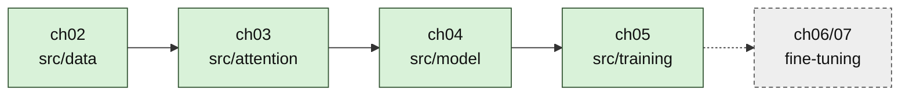

# Sprints

Material de estudo e experimentação de cada capítulo do livro *Build a Large
Language Model (From Scratch)*, uma pasta por capítulo (`chNN`), no padrão do
[repositório oficial](https://github.com/rasbt/LLMs-from-scratch). As Sprints 0
e 1 são uma única entrega (`ch01/`).

O código do modelo **não** fica aqui: ele é cumulativo e vive em
[`src/`](../src/). Cada capítulo acrescenta um módulo que reaproveita os
anteriores sem alterá-los.



## Índice

| Cap. | Sprint | Tema | Módulo em `src/` | Testes | Status |
|---|---|---|---|---:|---|
| [1](ch01/) | 0 + 1 | Ambiente e introdução aos LLMs | n/a | 4 | ✅ |
| [2](ch02/) | 2 | Tokenização, embeddings e DataLoader | [`data/`](../src/data/) | 17 | ✅ |
| [3](ch03/) | 3 | Self, causal e multi-head attention | [`attention/`](../src/attention/) | 17 | ✅ |
| [4](ch04/) | 4 | Transformer Block, GPTModel e geração | [`model/`](../src/model/) | 40 | ✅ |
| [5](ch05/) | 5 | Pré-treinamento, perda e decodificação | [`training/`](../src/training/) | 17 | ✅ |
| 6-7 | 6 | Fine-tuning (classificação e instruções) | n/a | n/a | ⬜ |

Clique em um capítulo para ver os entregáveis, o resultado principal e como
rodar.

<details>
<summary><b>Cap. 1</b> · Ambiente PyTorch e GPU</summary>

- **Entregáveis:** [glossário](ch01/glossario/ch01.md),
  [mapa conceitual](ch01/mapa_conceitual_gpt.md),
  [teste do ambiente](ch01/tests/test_ambiente_pytorch.py)
- **Resultado:** detecção de dispositivo CUDA, ROCm, MPS ou CPU, com
  operações reais na GPU quando ela existe.

```powershell
python -m pytest sprints/ch01/tests/ -v -s
```

</details>

<details>
<summary><b>Cap. 2</b> · Texto → Token IDs → embeddings → lotes</summary>

- **Entregáveis:** [glossário](ch02/glossario/ch02.md),
  [análise](ch02/docs/sprint2_analise.md),
  [notebook](ch02/notebooks/InteligenciaArtificial_SistemasInteligentes.ipynb),
  [fluxo](ch02/experiments/fluxo_sprint2.py)
- **Implementação:** `SimpleTokenizerV2`, BPE (`tiktoken`), `GPTDatasetV1`
  (pares entrada/alvo por janela deslizante), `create_dataloader_v1`,
  `GPTInputEmbeddings` (token + posição).
- **Resultado:** `the-verdict.txt` gera 5.145 tokens BPE; a saída do
  pipeline tem formato `(batch, context_length, emb_dim)`.

```powershell
python -m pytest sprints/ch02/tests/ -v
python sprints/ch02/experiments/fluxo_sprint2.py
```

</details>

<details>
<summary><b>Cap. 3</b> · softmax(QKᵀ / √d<sub>k</sub>) V</summary>

- **Entregáveis:** [glossário](ch03/glossario/ch03.md),
  [análise](ch03/docs/sprint3_analise.md),
  [notebook](ch03/notebooks/ch03.ipynb),
  [fluxo](ch03/experiments/fluxo_sprint3.py)
- **Implementação:** `SelfAttention_v1/v2`, `CausalAttention` (máscara
  triangular + dropout), `MultiHeadAttentionWrapper` e `MultiHeadAttention`
  (heads em paralelo + projeção de saída).
- **Resultado:** experimentos com nº de heads, dimensão das heads, escala e
  máscara causal, com visualização das matrizes de atenção (no notebook).

```powershell
python -m pytest sprints/ch03/tests/ -v
python sprints/ch03/experiments/fluxo_sprint3.py
```

</details>

<details>
<summary><b>Cap. 4</b> · GPTModel (GPT-2 small, 12 blocos × 12 heads)</summary>

- **Entregáveis:** [glossário](ch04/glossario/ch04.md),
  [análise](ch04/docs/sprint4_analise.md),
  [notebook](ch04/notebooks/ch04.ipynb),
  [fluxo](ch04/experiments/fluxo_sprint4.py)
- **Implementação:** `LayerNorm`, `GELU`, `FeedForward` (768 → 3072 → 768),
  `TransformerBlock` (pré-LayerNorm + atalhos), `GPTModel`, `generate`
  (gulosa, temperatura, top-k).
- **Resultado:** 163.009.536 parâmetros, ou 124.412.160 com *weight tying*,
  iguais ao livro. Logits no formato `(batch, tokens, 50257)`.

```powershell
python -m pytest sprints/ch04/tests/ -v
python sprints/ch04/experiments/fluxo_sprint4.py
```

</details>

<details>
<summary><b>Cap. 5</b> · Cross-entropy, AdamW e decodificação</summary>

- **Entregáveis:** [glossário](ch05/glossario/ch05.md),
  [análise](ch05/docs/sprint5_analise.md),
  [experimentos](ch05/experiments/resultados/experimentos_resumo.md)
- **Implementação:** `calc_loss_batch`, `perplexidade`, `train_model`
  (warmup, cosine decay, gradient clipping), `salvar_checkpoint` e
  `carregar_modelo`.
- **Resultado:** perda de validação de 10,981 → 6,452 em 10 épocas (treino
  0,420), em 63 s numa GTX 1650. Melhor validação na época 5 (6,087), depois
  overfitting.

```powershell
python -m pytest sprints/ch05/tests/ -v
python sprints/ch05/experiments/treino_modelo.py
python sprints/ch05/experiments/estrategias_geracao.py
```

</details>

## Convenção de pastas

```text
sprints/chNN/
├── README.md        # resumo, entregáveis e resultados
├── glossario/       # chNN.md
├── docs/            # análise técnica da sprint
├── notebooks/       # exploração em Jupyter
├── experiments/     # scripts reproduzíveis + resultados/
└── tests/           # pytest do capítulo (src/ importável via conftest.py)
```

Os testes dos Caps. 4 e 5 baixam o vocabulário BPE do GPT-2 na primeira
execução e precisam de internet nesse momento.