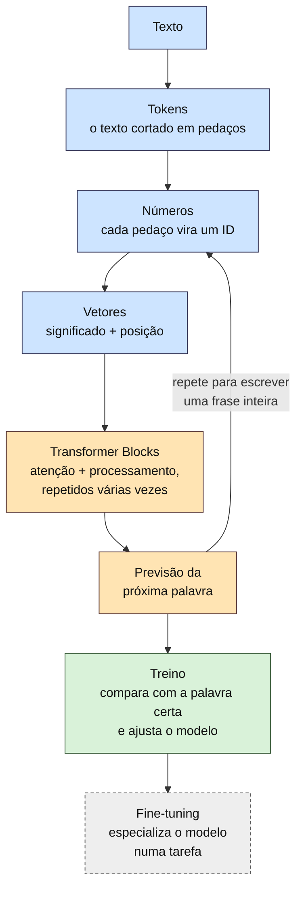
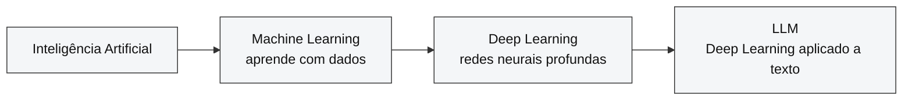

# Mapa Conceitual da Arquitetura GPT

Entregável da Sprint 1. Este mapa mostra, de forma resumida, o caminho que o
projeto constrói: um texto entra, vira números, passa pelo modelo e sai como
a previsão da próxima palavra. Os termos citados estão nos glossários de cada
capítulo.

## 1. Visão geral

Azul: Cap. 2 · Laranja: Caps. 3 e 4 · Verde: Cap. 5 · Cinza: Caps. 6 e 7

## 2. As etapas em poucas palavras

<b>Texto → tokens → números</b> (Cap. 2)

O computador não entende letras, só números. Por isso o texto é cortado em
pedaços (tokens) e cada pedaço recebe um número fixo, como num dicionário.

Termos: `Tokenization`, `Token`, `Vocabulary`, `Token ID` ·
Código: [`src/data/`](../../src/data/)

<b>Números → vetores</b> (Cap. 2)

O número de um token não diz nada sobre o seu significado. Então cada token
ganha uma lista de números (um vetor) que o modelo aprende, em que palavras
parecidas ficam próximas. A posição da palavra na frase também entra, porque
"o cão mordeu o homem" é diferente de "o homem mordeu o cão".

Termos: `Token Embedding`, `Positional Embedding` ·
Código: [`src/data/embeddings.py`](../../src/data/embeddings.py)

<b>Atenção</b> (Cap. 3)

É a parte que faz cada palavra "olhar" para as outras da frase e pegar o
contexto delas. Assim, "banco" numa frase sobre dinheiro fica diferente de
"banco" numa frase sobre praça. No GPT, cada palavra só olha para as que vêm
antes dela, nunca para as seguintes (atenção causal).

Termos: `Self-Attention`, `Causal Attention`, `Multi-Head Attention` ·
Código: [`src/attention/`](../../src/attention/)

<b>Transformer Block e modelo GPT</b> (Cap. 4)

O Transformer Block junta a atenção com uma etapa que processa cada palavra
e algumas peças que deixam o treino estável. O modelo GPT empilha vários
desses blocos (12 no GPT-2 pequeno) e, no final, dá uma nota para cada
palavra do vocabulário ser a próxima.

Termos: `Transformer Block`, `Layer Normalization`, `FeedForward Network`,
`Logits` · Código: [`src/model/`](../../src/model/)

<b>Geração de texto</b> (Caps. 4 e 5)

O modelo escolhe a próxima palavra, coloca no fim do texto e repete. É assim
que ele escreve uma frase inteira, uma palavra por vez. Dá para deixar a
escolha mais previsível ou mais criativa (temperatura e top-k).

Termos: `Autoregressive Generation`, `Temperature Scaling`, `Top-k Sampling` ·
Código: [`src/model/generation.py`](../../src/model/generation.py)

<b>Treino</b> (Cap. 5)

O modelo lê um texto, tenta adivinhar cada próxima palavra e compara com a
palavra certa. O erro é usado para ajustar o modelo, e isso se repete
muitas vezes. Não precisa de ninguém marcar respostas: o próprio texto é o
gabarito.

Termos: `Pretraining`, `Cross Entropy Loss`, `Overfitting` ·
Código: [`src/training/`](../../src/training/)

<b>Fine-tuning</b> (Caps. 6 e 7, ainda não feito)

Depois de treinado, o modelo pode ser especializado com poucos dados: por
exemplo, para classificar mensagens como spam ou para responder a pedidos.

Termos: `Fine-Tuning`, `Downstream Task`

## 3. Por que GPT e não BERT

Os dois vêm do Transformer, mas usam partes diferentes. O GPT é treinado
para adivinhar a próxima palavra, então só pode olhar para o que veio antes:
é bom para **gerar** texto. O BERT é treinado para preencher lacunas e olha
para a frase inteira: é bom para **entender e classificar** texto. Este
projeto segue o caminho do GPT.

## 4. Da IA ao LLM

Cada nível é um caso mais específico do anterior.

## 5. Onde cada Sprint entra

| Etapa | Sprint | Pasta | Status |
|---|---|---|---|
| Texto, tokens e vetores | 2 | [`ch02/`](../ch02/) | ✅ |
| Atenção | 3 | [`ch03/`](../ch03/) | ✅ |
| Transformer Block, GPT e geração | 4 | [`ch04/`](../ch04/) | ✅ |
| Treino | 5 | [`ch05/`](../ch05/) | ✅ |
| Fine-tuning | 6 | ainda não criada | ⬜ |