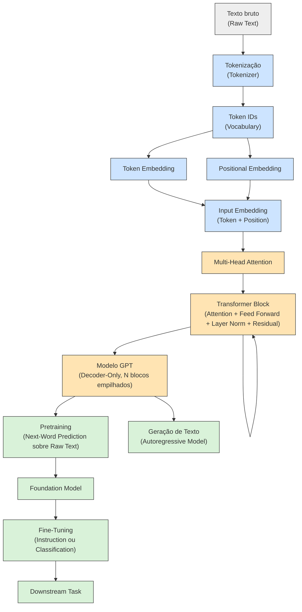
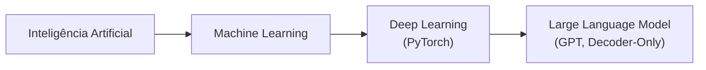

# Mapa Conceitual da Arquitetura GPT

Entregável da Sprint 1 (cronograma oficial, 06/08): "elaboração do glossário,
Quiz 1 e **mapa conceitual da arquitetura GPT**". Este documento organiza
visualmente os termos definidos em [`glossario/ch01.md`](glossario/ch01.md)
no fluxo geral que será implementado ao longo do projeto, do texto bruto até
a geração de texto — o mesmo roteiro descrito na Seção 9 ("Resultado Final
Esperado") do documento do Projeto LLM.

## 1. Visão geral do pipeline

Azul = Capítulo 2 (concluído, `src/data/`). Laranja = Capítulo 3 em diante
(atenção e arquitetura GPT, em andamento). Verde = treinamento, fine-tuning
e geração de texto (Capítulos 5 a 7, ainda não iniciados).

## 2. Onde cada Sprint entra no mapa

| Etapa do mapa | Conceitos (glossário) | Sprint | Status |
|---|---|---|---|
| Texto bruto → Token IDs | `Tokenization`, `Token`, `Vocabulary`, `Token ID`, `Special Context Tokens`, `Byte Pair Encoding` | 2 | ✅ |
| Token/Positional Embedding | `Token Embedding`, `Positional Embedding`, `Input Embedding` | 2 | ✅ |
| Multi-Head Attention | `Attention`, `Self-Attention`, `Query/Key/Value`, `Causal Attention`, `Multi-Head Attention` | 3 | ⬜ em andamento |
| Transformer Block / GPT | `Transformer`, `Decoder`, `Decoder-Only Architecture`, `GPT` | 4 | ⬜ |
| Pretraining / Foundation Model | `Pretraining`, `Next-Word Prediction`, `Self-Supervised Learning`, `Foundation Model`, `Autoregressive Model` | 5 | ⬜ |
| Fine-Tuning / Downstream Task | `Fine-Tuning`, `Instruction Fine-Tuning`, `Classification Fine-Tuning`, `Downstream Task` | 6 | ⬜ |

## 3. Por que Decoder-Only (GPT) e não Encoder (BERT)

O Transformer original tem `Encoder` e `Decoder`. O GPT descarta o
`Encoder` e empilha só `Decoder`s (`Decoder-Only Architecture`), treinado
por `Next-Word Prediction` — geração token a token, da esquerda para a
direita. O `BERT` é o caminho oposto: usa só o `Encoder`, treinado por
`Masked Word Prediction`, e por isso é melhor em classificação do que em
geração. Essa escolha arquitetural é o motivo de o mecanismo de atenção que
vamos implementar na Sprint 3 precisar ser **causal** (`Causal Attention`):
cada posição só pode olhar para tokens anteriores a ela, nunca para o
futuro — é isso que torna a geração autoregressiva possível.

## 4. Hierarquia de escala (IA → LLM)

Cada seta representa uma especialização: `Deep Learning` é o subcampo do
`Machine Learning` baseado em redes de múltiplas camadas ocultas; um `LLM`
é uma aplicação de `Deep Learning` a texto, usando `Transformer` como
espinha dorsal e `Embedding` como porta de entrada — a mesma cadeia descrita
no glossário do Capítulo 1.
