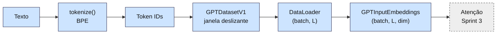

# Capítulo 2 · Trabalhando com dados de texto (Sprint 2)

Status: ✅ concluída

Transforma texto em tensores prontos para o modelo: tokenização, vocabulário,
Token IDs, pares entrada/alvo, embeddings de token e de posição e DataLoader.
O código fica em [`src/data/`](../../src/data/) e é reaproveitado pelos
capítulos seguintes.



## Entregáveis

| Entregável do roteiro | Onde está |
|---|---|
| Glossário do Cap. 2 | [`glossario/ch02.md`](glossario/ch02.md) |
| Tokenização, vocabulário e Token IDs | [`tokenizer.py`](../../src/data/tokenizer.py) |
| Sequências de treinamento | [`dataset.py`](../../src/data/dataset.py) |
| Embeddings e positional embeddings | [`embeddings.py`](../../src/data/embeddings.py) |
| Carregamento dos dados | [`dataloader.py`](../../src/data/dataloader.py) |
| Experimentos | [`notebooks/ch02.ipynb`](notebooks/ch02.ipynb) (seção 2.9) e [`experiments/fluxo_sprint2.py`](experiments/fluxo_sprint2.py) |
| Análise dos resultados | [`docs/sprint2_analise.md`](docs/sprint2_analise.md) |

Material de apoio para a arguição:
[`docs/sprint2_guia_de_estudo.md`](docs/sprint2_guia_de_estudo.md).

## Resultados principais

Corpus: [`data/the-verdict.txt`](../../data/the-verdict.txt).

| Medida | Valor |
|---|---|
| Caracteres | 20.479 |
| Tokens por palavra / vocabulário | 4.690 / 1.132 |
| Tokens BPE / vocabulário | 5.145 / 50.257 |
| Amostras com contexto 2 → 128 (stride = contexto) | 2.572 → 40 |
| Token embedding com `dim` 256 e 768 | 12,9 M e 38,6 M parâmetros |

<details>
<summary>O que cada experimento mostrou</summary>

- **Tokens por texto:** cerca de 4 caracteres por token BPE em inglês.
- **Palavras × BPE:** a mesma frase dá 16 tokens por palavra e 21 em BPE,
  mas o BPE nunca precisa de `<|unk|>`.
- **Contexto:** dobrar o contexto corta as amostras pela metade,
  `amostras = ⌈(N − L) / S⌉`.
- **Stride:** stride menor gera mais amostras, com sobreposição; maior que
  o contexto, pula tokens.
- **Lote:** `batch_size` muda só o primeiro eixo do tensor.
- **Dimensão do embedding:** parâmetros crescem linearmente, `vocab × dim`.
- **Posição:** o mesmo token em posições diferentes só fica diferente depois
  de somar o positional embedding.

Tabelas completas em [`docs/sprint2_analise.md`](docs/sprint2_analise.md).

</details>

## Como rodar

```powershell
python -m pytest sprints/ch02/tests/ -v           # 17 testes
python -m pytest sprints/ch02/tests/ -s -v        # com os prints demonstrativos
python sprints/ch02/experiments/fluxo_sprint2.py  # fluxo de ponta a ponta
jupyter lab sprints/ch02/notebooks/ch02.ipynb     # experimentos
```

O BPE (`tiktoken`) baixa o vocabulário do GPT-2 na primeira execução.

## Conteúdo da pasta

```text
ch02/
├── glossario/ch02.md
├── docs/
│   ├── sprint2_analise.md          # análise e respostas às 10 perguntas
│   └── sprint2_guia_de_estudo.md   # apoio para a arguição
├── notebooks/ch02.ipynb            # capítulo executado + experimentos (2.9)
├── experiments/fluxo_sprint2.py    # fluxo reproduzível de ponta a ponta
└── tests/                          # tokenizer, dataset, dataloader, embeddings
```