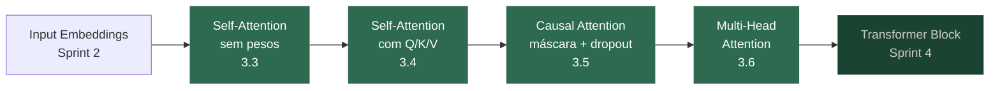

# Capítulo 3 — Mecanismos de Atenção

> Sprint 3 do projeto **Asphal-LLM** · continua a partir do [Capítulo 2](../ch02/)



## Estrutura

```
ch03/
├── README.md
├── glossario/ch03.md                       # 10 termos do capítulo
├── docs/sprint3_analise.md                 # análise técnica + respostas
├── notebooks/ch03.ipynb                    # notebook executado (3.3 → 3.6)
├── experiments/
│   ├── fluxo_sprint3.py                    # demo + 7 experimentos
│   └── resultados/matriz_de_atencao.png
└── tests/
    ├── test_self_attention.py              # seções 3.3 e 3.4
    ├── test_causal_attention.py            # seção 3.5
    └── test_multi_head_attention.py        # seção 3.6
```

O código reutilizável fica em [`src/attention/`](../../src/attention/) — será aproveitado pelo `TransformerBlock` na Sprint 4.

## Como rodar

```bash
# Testes
python -m pytest sprints/ch03/tests/ -v

# Experimentos + heatmap
python sprints/ch03/experiments/fluxo_sprint3.py
```

## O que foi implementado

<details>
<summary>3.3 Self-Attention sem pesos treináveis</summary>

`attention_scores_simples()` — produto escalar direto entre embeddings.  
Referência do livro: vetor de contexto do token "journey" = `[0.4419, 0.6515, 0.5683]` ✅

</details>

<details>
<summary>3.4 Self-Attention com Q/K/V (Scaled Dot-Product)</summary>

- `SelfAttention_v1` — pesos como `nn.Parameter`; fiel ao livro  
- `SelfAttention_v2` — pesos como `nn.Linear`; usada dali em diante  
- Escalonamento por `sqrt(d_out)` evita saturação do softmax em dimensões altas

</details>

<details>
<summary>3.5 Causal Attention</summary>

- Máscara causal: `torch.triu(diagonal=1)` + `masked_fill_(-inf)`  
- Suporte a lote (`batch_size, seq_len, d_out`)  
- Dropout nos pesos de atenção (desligado em `.eval()`)

</details>

<details>
<summary>3.6 Multi-Head Attention</summary>

| Classe | Como funciona | Uso |
|---|---|---|
| `MultiHeadAttentionWrapper` | várias `CausalAttention` em loop | didática |
| `MultiHeadAttention` | uma projeção Q/K/V + `view`/`transpose` | Sprint 4 |

`head_dim = d_out / num_heads` — `d_out` precisa ser divisível por `num_heads`.

</details>

## Resultados dos testes

| Suite | Testes |
|---|---|
| `test_self_attention.py` | 17 |
| `test_causal_attention.py` | 17 |
| `test_multi_head_attention.py` | 17 |
| **Total** | **17** |

Detalhes numéricos e respostas conceituais → [`docs/sprint3_analise.md`](docs/sprint3_analise.md)