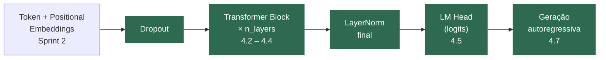

# Capítulo 4 — Implementando o Modelo GPT

Status: ✅ concluída

> Sprint 4 do projeto **Asphal-LLM** · continua a partir do [Capítulo 3](../ch03/)



## Estrutura

```
ch04/
├── README.md
├── glossario/ch04.md                       # 17 termos do capítulo
├── docs/sprint4_analise.md                 # análise técnica + respostas
├── notebooks/ch04.ipynb                    # notebook executado (4.1 → 4.7)
├── experiments/
│   ├── fluxo_sprint4.py                    # demo + 7 experimentos
│   └── resultados/sprint4_resultados.json
└── tests/
    ├── test_layer_norm.py                  # seção 4.2
    ├── test_feed_forward.py               # seção 4.3
    ├── test_transformer_block.py          # seção 4.4
    ├── test_gpt_model.py                  # seção 4.5
    └── test_generation.py                 # seções 4.6 e 4.7
```

O código reutilizável fica em [`src/model/`](../../src/model/) — será aproveitado pelo treinamento na Sprint 5.

## Configurações usadas

| Config | vocab | context | emb_dim | heads | layers | Parâmetros |
|---|---:|---:|---:|---:|---:|---:|
| `GPT_CONFIG_124M` (GPT-2 small) | 50.257 | 1.024 | 768 | 12 | 12 | 163.009.536 |
| `GPT_CONFIG_MINI` (projeto) | 50.257 | 128 | 128 | 4 | 4 | 13.673.984 |

## Como rodar

```bash
# Testes
python -m pytest sprints/ch04/tests/ -v

# Experimentos + resultados JSON
python sprints/ch04/experiments/fluxo_sprint4.py
```

## O que foi implementado

<details>
<summary>4.2 Layer Normalization</summary>

`LayerNorm` — normaliza cada vetor de token para média 0 e variância 1, depois aplica scale e shift aprendidos. Aparece antes de cada sub-camada e ao final do modelo.

</details>

<details>
<summary>4.3 FeedForward + GELU</summary>

`FeedForward` — duas lineares com GELU no meio. Expande 768 → 3.072 → 768.  
`GELU` — ativação suave que não zera negativos, mantendo gradiente em todos os neurônios.

</details>

<details>
<summary>4.4 Transformer Block + conexões residuais</summary>

`TransformerBlock` — LayerNorm → MHA → atalho, LayerNorm → FF → atalho.  
Conexões residuais (`x + camada(x)`) resolvem o desaparecimento do gradiente e preservam a informação original.

</details>

<details>
<summary>4.5 – 4.7 Modelo GPT completo + geração</summary>

`GPTModel` — embeddings → dropout → N blocos → LayerNorm → LM Head.  
`generate` — geração autoregressiva com temperatura e top-k.  
`aplicar_top_k` — descarta tokens fora do top-k antes do softmax.

</details>

## Resultados dos testes

| Suite | Testes |
|---|---|
| `test_layer_norm.py` | 4 |
| `test_feed_forward.py` | 7 |
| `test_transformer_block.py` | 5 |
| `test_gpt_model.py` | 10 |
| `test_generation.py` | 10 |
| **Total** | **36** |

Detalhes numéricos e respostas conceituais → [`docs/sprint4_analise.md`](docs/sprint4_analise.md)