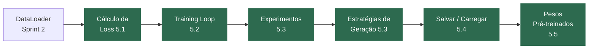

# Capítulo 5 — Pré-treinamento em Dados Não Rotulados

> Sprint 5 do projeto **Asphal-LLM** · continua a partir do [Capítulo 4](../ch04/)



## Estrutura

```
ch05/
├── README.md
├── glossario/ch05.md                         # 32 termos do capítulo
├── docs/sprint5_analise.md                   # análise técnica + respostas
├── experiments/
│   ├── avaliacao_modelo.py                   # 5.1: cross-entropy e perplexity
│   ├── treino_modelo.py                      # 5.2: laço de treinamento
│   ├── experimentos_treino.py                # 5.3: 8 experimentos comparativos
│   ├── estrategias_geracao.py                # 5.3: gulosa × temperatura × top-k
│   ├── salvar_carregar.py                    # 5.4: checkpoint e continuação
│   └── resultados/                           # JSON e resumos de cada script
└── tests/
    ├── test_losses.py                        # seções 5.1.2 e 5.1.3
    ├── test_treino.py                        # seção 5.2 + apêndice D
    └── test_checkpoint.py                   # seção 5.4
```

O código reutilizável fica em [`src/training/`](../../src/training/):
`losses.py`, `treino.py`, `checkpoint.py`, `dados.py`, `graficos.py`, `dispositivo.py`.

## Como rodar

```bash
# Testes
python -m pytest sprints/ch05/tests/ -v

# Avaliação inicial (< 1 min)
python sprints/ch05/experiments/avaliacao_modelo.py

# Treino do livro — GPT-2 124M, 10 épocas (~1 min na GTX 1650)
python sprints/ch05/experiments/treino_modelo.py

# 8 experimentos comparativos (~13 min)
python sprints/ch05/experiments/experimentos_treino.py

# Estratégias de geração e checkpoint (requer modelo salvo)
python sprints/ch05/experiments/estrategias_geracao.py
python sprints/ch05/experiments/salvar_carregar.py
```

> Os pesos são salvos em `models/ch05/` (fora do git — ~1,9 GB com otimizador).

## Principais resultados

| Métrica | Resultado |
|---|---|
| Perda inicial (sem treino) | treino **10,988** · validação **10,981** |
| Após 10 épocas (livro) | treino **0,420** · validação **6,452** |
| Melhor validação | **6,087** na época 5 |
| Tempo de treino | 63 s na GTX 1650 |
| Geração | top-k 25 + T 1,4 = mais diverso sem perder sentido |
| Checkpoint | pesos 623 MB · com AdamW 1.862 MB |

<details>
<summary>8 experimentos comparativos</summary>

| Exp | Configuração | Val final |
|---|---|---|
| 01 | Baseline (livro) | 6,452 |
| 02 | lr alta (0,001) | 6,820 (não converge) |
| 03 | lr baixa (0,0001) | 6,618 |
| 04 | 30 épocas | 7,297 (overfitting severo) |
| 05 | Sem dropout/weight decay | 6,310 (overfitting mais rápido) |
| 06 | Warmup + cosine decay + grad clip | **6,230** |
| 07 | Config MINI (13M params) | 7,891 |
| 08 | Config 124M completo | 6,452 |

</details>

## Resultados dos testes

| Suite | Testes |
|---|---|
| `test_losses.py` | 8 |
| `test_treino.py` | 6 |
| `test_checkpoint.py` | 3 |
| **Total** | **17** |

Análise completa e discussão → [`docs/sprint5_analise.md`](docs/sprint5_analise.md)